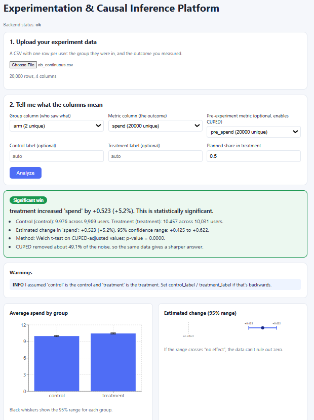
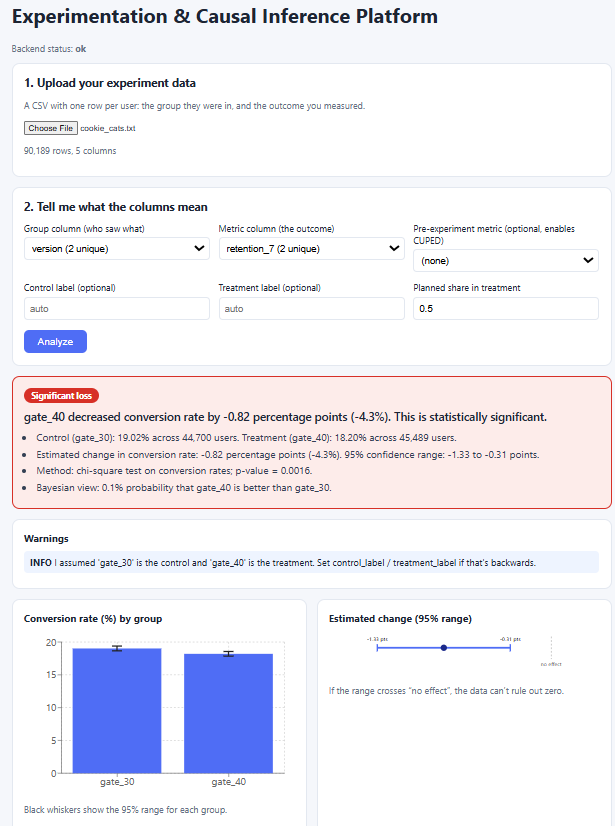
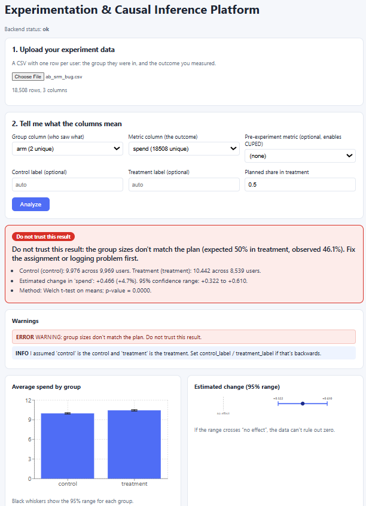

# Experimentation & Causal Inference Platform

An internal tool that helps teams design A/B tests, analyze them correctly, and estimate
cause and effect when an experiment isn't possible. It doesn't just compute a p-value: it
checks whether the experiment **can be trusted**, and says so in plain English.



## Why this exists

Most A/B-testing mistakes are not arithmetic errors, they are trust problems:

- the groups weren't split the way the team planned (a logging bug),
- someone checked results every day and stopped when it "looked significant",
- a handful of extreme users dominated an average,
- nobody randomized, so the groups differed from the start.

This platform detects these problems, applies the right method, and reports the answer with its
uncertainty.

## What it does

| Question | Where | Highlights |
|---|---|---|
| How many users do I need? | `power.py` | Sample size for conversion and mean metrics |
| Can I trust this A/B test? | `experiments.py`, `analyze.py` | Sample-ratio-mismatch alarm, missing-data and extreme-value checks, CUPED variance reduction |
| Is B better than A? | `experiments.py`, `bayesian.py` | Chi-square / Welch tests, Bonferroni and Benjamini-Hochberg corrections, Bayesian "probability B beats A" (PyMC, verified against the exact solution) |
| Can I peek at results early? | `sequential.py` | Peeking simulation and an always-valid (mSPRT) stopping rule |
| What if nobody randomized? | `causal.py` | Propensity matching, DoWhy, EconML, difference-in-differences with a pre-trend check, synthetic control with placebo tests |
| Can I use it on my own data? | `analyze.py` + React app | Upload a CSV, pick the columns, get a verdict with warnings and charts |

## Results

### Validation on simulated data (the true answer is known)

Every method is graded where the correct answer is planted in the data (default seed).

| Experiment | Result |
|---|---|
| Checking results daily (10 looks, no real effect) | False wins rise from **4.9%** (look once) to **19.4%** (stop when p < 0.05). The always-valid method keeps them at **1.1%**. |
| Cost of that safety | At a true effect of 0.05 it detects the effect **35%** of the time, versus 71% for a single look. Safe peeking is conservative. |
| CUPED variance reduction (pre/post correlation 0.7) | Removes **49%** of the noise, matching the theory (1 - 0.7^2). |
| Self-selected users, true effect = 2.0 | Naive comparison: **5.02**. Regression 2.03, matching 2.11, DoWhy 2.10, EconML 2.06. |
| Same, with an unmeasured driver of opt-in | **Every** method is biased (3.7 to 3.8 instead of 2.0). Observational estimates depend on assumptions. |
| Policy hit one place, parallel trends violated (true effect -3) | Difference-in-differences: **+0.67** (wrong sign; its pre-trend check flags the problem). Synthetic control: **-2.58**. |
| Same, but no real effect | Difference-in-differences invents an effect of **+3.67**. Synthetic control: 0.42, not significant. |
| Bayesian check | P(B beats A) = 0.982, equal to 1 - p/2 from the frequentist test, as theory predicts. |

### Real data: Cookie Cats (gate at level 30 vs level 40)

About 90,000 players, randomly assigned. Three metrics were tested, so p-values were corrected
(Benjamini-Hochberg and Bonferroni agree).

| Metric | gate_30 | gate_40 | Change (95% range) | Adjusted p | Verdict |
|---|---|---|---|---|---|
| Returned after 1 day | 44.82% | 44.23% | -0.59 pts (-1.24 to +0.06) | 0.11 | Inconclusive |
| Returned after 7 days | 19.02% | 18.20% | -0.82 pts (-1.33 to -0.31) | **0.0048** | **Significant loss** |
| Rounds played (average) | 52.46 | 51.30 | -1.16 | 0.38 | Inconclusive |

The later gate **lowered 7-day retention by about 8 players per 1,000**. The apparent gap in rounds
played is almost entirely **one player** with 49,854 rounds (without that player, the averages are
51.34 and 51.30). Full write-up: [docs/case-studies/cookie-cats.md](docs/case-studies/cookie-cats.md).



## Quick start

Requirements: Python 3.11 or 3.12, Node.js 18+.

**Backend** (terminal 1):
```bash
cd backend
python -m venv .venv
source .venv/bin/activate          # Windows: .venv\Scripts\activate
pip install -r requirements.txt    # PyMC, DoWhy and EconML are large; allow several minutes
python -m pytest -q                # 57 tests (about 5 minutes with the heavy libraries)
python scripts/make_sample_data.py # creates CSVs to upload
uvicorn app.main:app --reload      # wait ~10 s; API docs at http://127.0.0.1:8000/docs
```

**Frontend** (terminal 2):
```bash
cd frontend
npm install                        # if npm reports a peer-dependency conflict: npm install --legacy-peer-deps
npm run dev                        # http://localhost:5173
```

Try the files in `backend/sample_data/`:

| File | What it shows |
|---|---|
| `ab_continuous.csv` | A real win, sharpened by CUPED |
| `ab_srm_bug.csv` | **"Do not trust this result"**: the groups don't match the plan |
| `ab_heavy_tail.csv` | **"Unreliable result"**: five extreme users create a fake win |



The Cookie Cats data is not included. Download it from Kaggle and upload it in the app.

## Project structure

```
experimentation-platform/
├── backend/
│   ├── app/         FastAPI service and statistics code
│   ├── tests/       57 automated tests
│   └── scripts/     sample-data generator and a data-inspection helper
├── frontend/        React app (Vite + Recharts)
└── docs/            Architecture notes and case studies
```

Design details and the API list: [docs/architecture.md](docs/architecture.md).

## Known limitations

- Upload analysis covers **randomized A/B tests**. The causal methods currently run on simulated
  data (via the API) rather than uploaded files.
- The always-valid sequential test is safe but conservative (see the power numbers above).
- The difference-in-differences pre-trend check needs at least 3 pre-policy periods.
- Averages of heavy-tailed metrics are fragile. The tool flags this but does not yet offer
  median or bootstrap comparisons.
- Not built yet: uplift modeling (who benefits most), deployment, front-end tests.

## Tech stack

Python, FastAPI, pandas, SciPy, statsmodels, scikit-learn, PyMC, DoWhy, EconML, React, Vite,
Recharts, pytest.