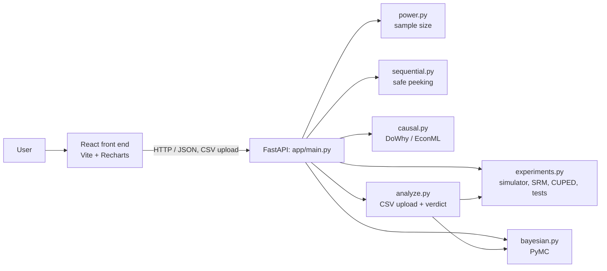

# Architecture

## How a request flows

1. The user picks a CSV in the React app. The app sends it to `/analyze/preview` and shows the columns.
2. The user confirms the group and metric columns and presses Analyze. The app posts the file and
   column choices to `/analyze/ab`.
3. `analyze.py` runs the trust checks, calls the statistics in `experiments.py` and `bayesian.py`,
   and returns a verdict, warnings and chart-ready numbers. The app draws them.

## Modules

| Module | Purpose |
|---|---|
| `power.py` | Power and sample-size calculator |
| `experiments.py` | Simulator, sample-ratio check, CUPED, Welch and chi-square tests, p-value corrections |
| `sequential.py` | Peeking simulation and the mSPRT stopping rule |
| `bayesian.py` | Bayesian A/B (probability B beats A), exact and PyMC engines |
| `causal.py` | Propensity matching, DoWhy, EconML, difference-in-differences, synthetic control |
| `analyze.py` | CSV validation, doctor checks, plain-English verdicts |
| `main.py` | FastAPI endpoints |

## API

Interactive documentation is generated automatically at `/docs`.

| Method | Path | Purpose |
|---|---|---|
| GET | `/health` | Liveness check |
| POST | `/power/proportions`, `/power/means` | Sample size |
| POST | `/doctor/srm` | Sample ratio mismatch check |
| POST | `/experiments/proportions` | Compare two conversion rates |
| POST | `/experiments/adjust-pvalues` | Bonferroni / Benjamini-Hochberg correction |
| POST | `/sequential/check`, `/sequential/peeking-demo` | Safe stopping rule and peeking simulation |
| POST | `/bayesian/ab` | Probability B beats A, expected loss |
| POST | `/causal/compare`, `/causal/panel-compare` | Causal methods vs a known true effect |
| POST | `/analyze/preview`, `/analyze/ab` | CSV upload analysis |

## Design decisions

- **Simulate first.** A generator with a known true effect lets every method be graded.
- **Trust before p-values.** Diagnostics run before any result is reported.
- **Plain-English output.** The verdict states what happened and what it can't tell you.